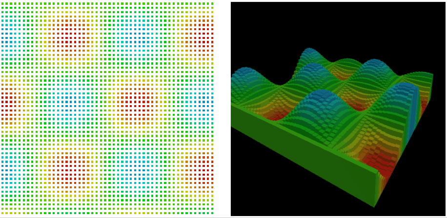
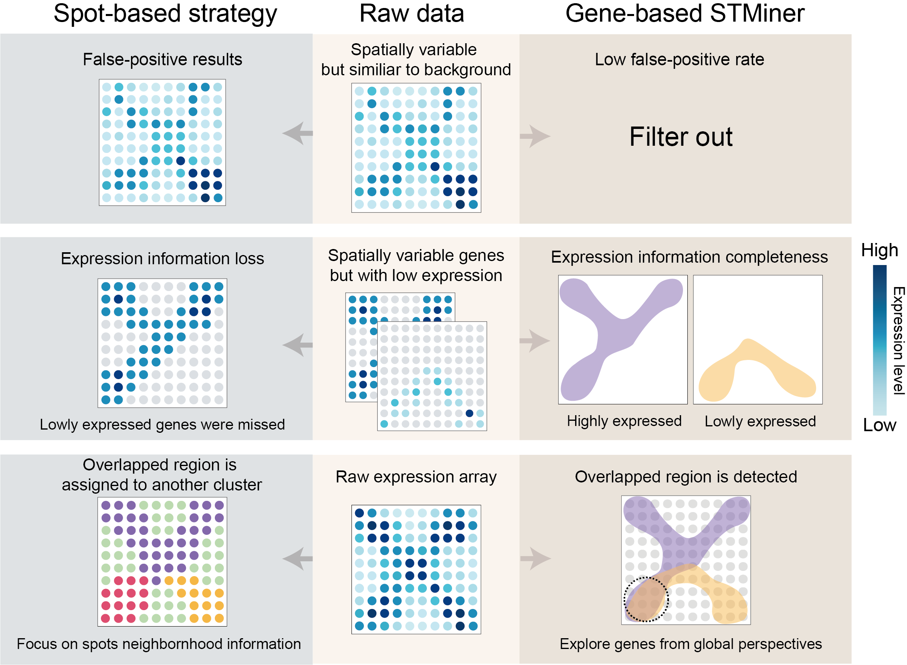
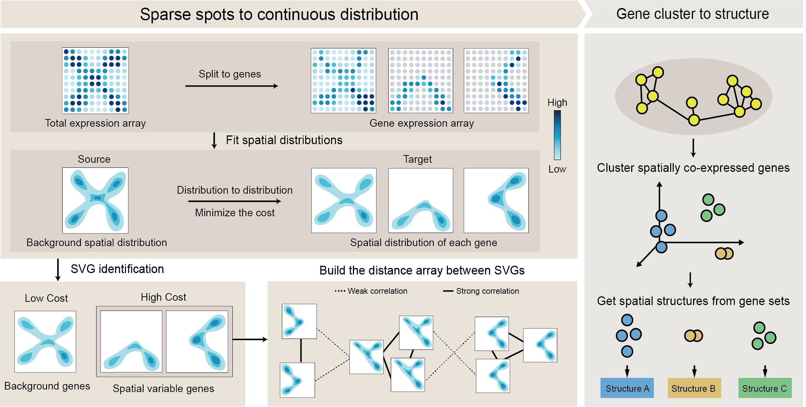
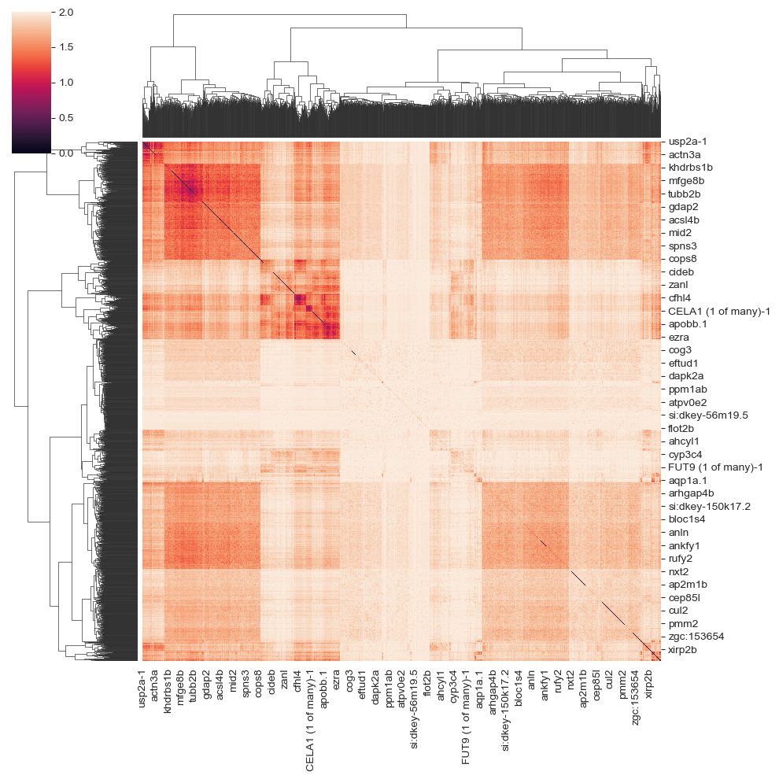
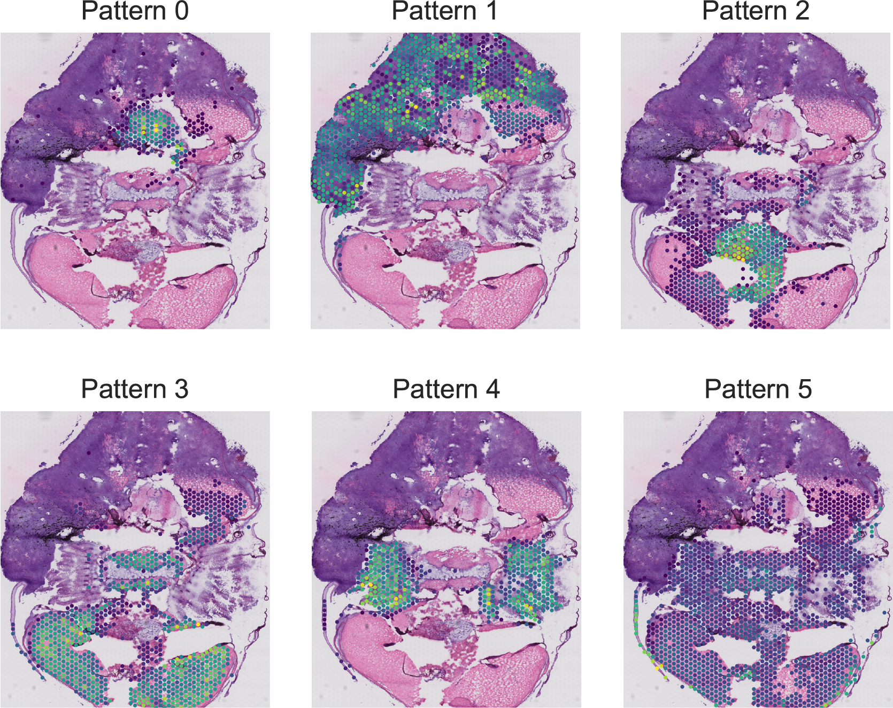
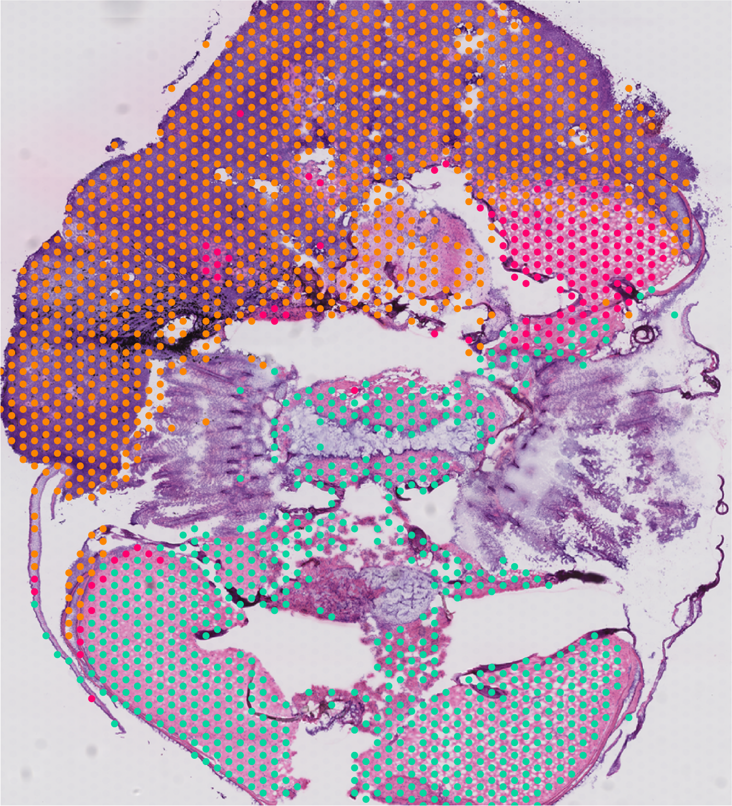

[](https://stminerdoc.readthedocs.io/en/latest/?badge=latest)


<div align=center></div>
<p align="center">
 <a href="https://stminerdoc.readthedocs.io/en/latest/Introduction/Introduction.html">📖 Documents</a> | <a href="https://stminerdoc.readthedocs.io/en/latest/Tutorial/Tutorial.html">🚀 Tutorial</a> | <a href="https://x.com/Sun_python">💬 Contact me</a>
</p>
<div align=center></div>
<p align="center"><b>Core Concept: Discrete to Continuous</b></p>

---

<div align=center >
 <p> <b>Please ⭐Star STMiner on Github if you find it's useful, thank you!😊</b></p>
</div>

---

# 👩‍🏫 Introduction

## Why STMiner?

ST data presents challenges such as uneven cell density distribution, low sampling rates, and complex spatial
structures. Traditional spot-based analysis strategies struggle to effectively address these issues. STMiner explores ST
data by leveraging the spatial distribution of genes, thus avoiding the biases that these conditions can introduce into
the results.<br>

Most importantly, STMiner offers **seamless integration with** [**Anndata**](https://github.com/scverse/anndata) / [**Scanpy**](https://github.com/scverse/scanpy) and can be **easily installed**
via [PyPI](https://pypi.org/project/STMiner/).<br>

<div align=center></div>

## Method detail

Here we propose “**STMiner**”. The three key steps of analyzing ST data in STMiner are depicted.

<div align=center></div>

(**Left top**) STMiner first utilizes Gaussian Mixture Models (GMMs) to represent the spatial distribution of each gene
and the overall spatial distribution. (**Left bottom**) STMiner then identifies spatially variable genes by calculating
the cost that transfers the overall spatial distribution to gene spatial distribution. Genes with high costs exhibit
significant spatial variation, meaning their expression patterns differ considerably across different regions of the
tissue. The distance array is built between SVGs in the same way, genes with similar spatial structures have a low cost
to transport to each other, and vice versa. (**Right**) The distance array is embedded into a low-dimensional space by
Multidimensional Scaling, allowing for clustering genes with similar spatial expression patterns into distinct
functional gene sets and getting their spatial structure.

# 🚀 Quick start by example

**Please visit [STMiner Documents](https://stminerdoc.readthedocs.io/en/latest/Introduction/Introduction.html) for
installation and detail usage.**

💡💡💡 We also provide a step-by-step [Jupyter Notebook](https://jupyter.org/) file to reproduce the results. You can
access it [**here**](https://github.com/PSSUN/STMiner-test-data/blob/main/STARprotocols.ipynb).

Additionally, you can run STMiner on your own:

## Import package

```python
from STMiner import SPFinder
```

## KEGG, GO, and gene-set enrichment

`KEGGFinder` provides validated wrappers for KEGG entries, QuickGO annotations,
UniProt searches and identifier mapping. Functional enrichment delegates to the
existing `scanpy.queries.enrich()` interface backed by g:Profiler.

```python
from STMiner import KEGGFinder

finder = KEGGFinder(timeout=30)

# Retrieve an organism-specific KEGG pathway and its genes.
finder.find("hsa00010")
pathway_genes = finder.get_gene_dataframe(strict=True)

# Run GO or KEGG enrichment for one gene set.
genes = ["TP53", "BRCA1", "BRCA2", "ATM", "CHEK2"]
go_result = finder.enrich_go(genes, organism="hsapiens")
kegg_result = finder.enrich_kegg(genes, organism="hsapiens")

# Profile several named gene clusters in one request.
clusters = {
    "DNA_damage": genes,
    "stemness": ["KLF4", "PAX5", "SOX2", "NANOG"],
}
cluster_result = finder.cluster_gene_set(clusters, organism="hsapiens")

# Create a Nature-style bubble plot and export vector artwork.
fig, axes = finder.plot_enrichment(
    cluster_result,
    top_n=5,
    save_path="gene_cluster_enrichment.pdf",
)
```

KEGG queries use KEGG organism codes such as `hsa` or `mmu`. g:Profiler
enrichment uses organism names such as `hsapiens` or `mmusculus`. By default,
enrichment results contain only significant terms and retain the intersecting
genes returned by g:Profiler. In the enrichment plot, color represents
`-log10(adjusted P)` and point size represents the number of intersecting genes.

## Load data

You can download them from [STMiner-test-data](https://github.com/PSSUN/STMiner-test-data). You can also download the
raw dataset from [GEO](https://www.ncbi.nlm.nih.gov/geo/query/acc.cgi?acc=GSM4838133), STMiner can read spatial
transcriptome data in various formats, such as **gem**, **bmk**, and **h5ad** (
see [STMiner Documents](https://stminerdoc.readthedocs.io/en/latest/Introduction/Introduction.html)).   
We recommend using the **h5ad** format, as it is currently the most widely used and supported by most algorithms and
software in the spatial transcriptomics field.

```python
sp = SPFinder()
file_path = 'Path/to/your/h5ad/file'
sp.read_h5ad(file=file_path, bin_size=1)
```

For high resolution ST data. You can increase the **bin_size** parameter when loading the data to reduce running time,
for example:

```python
sp.read_h5ad(file=file_path, bin_size=50, merge_bin=True)
```

This will not reduce the accuracy of STMiner, as resolution generally does not affect the spatial distribution of genes.

## Find spatial high variable genes

```python
sp.get_genes_csr_array(min_cells=100, log1p=False,, normalize = False, vmax = 100)
sp.spatial_high_variable_genes(thread=6)
```

- The parameter **min_cells** was used to filter genes that are too sparse to generate a reliable spatial distribution.
- The parameter **log1p** was used to avoid extreme values affecting the results. For most open-source h5ad files, log1p
  has already been executed, so the default value here is False.
- You can perform STMiner in your interested gene sets. Use parameter **gene_list** to input the gene list to STMiner.
  Then, STMiner will only calculate the given gene set of the dataset.

You can check the distance of each gene by:

```python
sp.global_distance
```

| Gene       | Distance | z-score  |
|------------|----------|----------|
| myha       | 1.35E+08 | 2.771493 |
| vmhcl      | 1.01E+08 | 2.470881 |
| zgc:101560 | 9.95E+07 | 2.458787 |
| pvalb1     | 9.82E+07 | 2.445257 |
| myhz2      | 9.75E+07 | 2.437787 |
| ...        | ...      | ...      |
| rps17      | 2.61E+05 | -3.63207 |
| rpl13      | 2.48E+05 | -3.68506 |
| rpl32      | 2.43E+05 | -3.70327 |
| rsl24d1    | 2.27E+05 | -3.7757  |
| rpl22      | 1.83E+05 | -3.99332 |

The 'Gene' column is the gene name, and the 'Distance' column is the difference between the spatial distribution of the
gene and the background.</br>
A larger difference indicates a more pronounced spatial pattern of the gene.

## Preprocess and Fit GMM

```python
sp.fit_pattern(n_comp=10, gene_list=list(sp.global_distance[:2000]['Gene']))
```

**n_comp=20** means each GMM model has 20 components.

## Build distance matrix & clustering

```python
# This step calculates the distance between genes' spatial distributions.
sp.build_distance_array()
# Dimensionality reduction and clustering.
sp.cluster_gene(n_clusters=6, mds_components=20) 
```

## Result & Visualization

The result is stored in **genes_labels**:

```python
sp.genes_labels  # check the gene label
# If you want to save this table, run:
sp.genes_labels.to_csv('genes_labels.csv')
```

The output looks like the following:

|    | gene_id        | labels |
|----|----------------|--------|
| 0  | Cldn5          | 2      |
| 1  | Fyco1          | 2      |
| 2  | Pmepa1         | 2      |
| 3  | Arhgap5        | 0      |
| 4  | Apc            | 5      |
| .. | ...            | ...    |
| 95 | Cyp2a5         | 0      |
| 96 | X5730403I07Rik | 0      |
| 97 | Ltbp2          | 2      |
| 98 | Rbp4           | 4      |
| 99 | Hist1h1e       | 4      |

### Visualize the distance array:

```python
import seaborn as sns

sns.clustermap(sp.genes_distance_array)
```

<div align=center></div>

### Finding gene sets with interested structure

Get patterns of interested gene/gene set:

```python
interested_genes = ["mbpa", "BX957331.1", "madd"]
sp.get_pattern_of_given_genes(gene_list=interested_genes, n_comp=10)
```

Compare the distance between all genes and the given gene set

```python
from STMiner.Algorithm.distance import compare_gmm_distance

df = compare_gmm_distance(sp.custom_pattern, sp.patterns)
df.to_csv('compare_distance.csv')
df
```

| Gene              | distance           |
|-------------------|--------------------|
| mbpa              | 0.8914643122002152 |
| map1ab            | 0.9479574709875033 |
| snap25a           | 0.9801858512442632 |
| nsfa              | 0.9948239449738531 |
| stxbp1a           | 0.99916307128497   |
| ...               | ...                |
| lrrfip1b          | 1.9981586323013931 |
| si:ch211-145h19.2 | 1.9995115533927301 |
| BX248122.1        | 1.9996375745511945 |
| si:dkey-7i4.24    | 1.9997052371268462 |

A lower distance indicates that the spatial expression pattern of the gene is more similar to that of the gene set of
interest.

### To visualize the patterns:

Layout, spot size, and colorbars are automatic. No background image is required.

```python
sp.get_pattern_array(vote_rate=0.2)
fig, axes = sp.plot.plot_pattern()

# Select panels and export without opening an interactive window.
fig, axes = sp.plot.plot_pattern(
    labels=[0, 1], shared_scale=True, output_path="patterns.pdf", show=False,
)
```

Use `heatmap=True` for a pixel map, `plot_bg=True` for measured tissue positions,
and `colorbar=False` for a compact image-only panel. `vmax=99` remains an upper
**percentile**, calculated from positive intensities. By default each panel has
its own scale; `shared_scale=True` uses a pooled scale for all selected patterns.
The scale shows composite pattern intensity and does not normalize by gene count.
Input matrices and their precision are preserved. All-zero patterns show "No signal".

Scatter and heatmap now share the same `[x, y]` coordinates and equal aspect ratio.
Legacy `num_cols`, `s`, `rotate`, `reverse_x`, `reverse_y`, `rotate_img`, `k`, and
`aspect` remain supported. Under the historical matrix convention, `rotate=True`
looks clockwise, `reverse_x` flips displayed y, and `reverse_y` flips displayed x.
Background images now follow these transforms too. Supply an image already aligned
to the **untransformed** grid via `image_path`; it is fitted to the grid extent,
not registered from pixel coordinates. `rotate_img=True, k=1` optionally rotates
the source image before the common transform. Older heatmaps used a different
row/column orientation, and old manually compensated image orientations may need
updating. The processed example image is available
[here](https://github.com/xjtu-omics/STMiner/blob/main/pic/demo_img.png).

`output_path` infers PDF/SVG/PNG/TIFF/EPS from the suffix (PDF when absent), with
600 DPI for raster export. `figsize=(width, height)` accepts inches and `dpi`
controls resolution. Returned `axes` is always two-dimensional; unused slots are
hidden. Close figures with `plt.close(fig)` after batch export.

<div  align="center">    
  
</div>

### Visualize the intersections between patterns 3 & 1:

```python
sp.plot.plot_intersection(pattern_list=[0, 1],
                          image_path="path/to/downloaded/demo_img.png",
                          reverse_y=True,
                          reverse_x=True,
                          aspect=0.55,
                          s=20)
```

<div  align="center">    
  
</div>

### To visualize the gene expression by labels:

```python
sp.plot.plot_genes(label=0, vmax=99)
```

## Attributes of STMiner.SPFinder Object

| Attributes           | Type          | Description                            |
|----------------------|---------------|----------------------------------------|
| adata                | Anndata       | Anndata for loaded spatial data        |
| patterns             | dict          | Spatial distributions pattern of genes |
| genes_patterns       | dict          | GMM model for each gene                |
| global_distance      | pd. DataFrame | Distances between genes and background |
| mds_features         | array         | embedding features of genes            |
| genes_distance_array | pd. DataFrame | Distance between each GMM              |
| genes_labels         | pd. DataFrame | Gene name and their pattern labels     |
| plot                 | Object        | Call plot to visualization             |

# 📜 Release history

| Version | Date       | Description                                                  |
|---------|------------|--------------------------------------------------------------|
| 1.1.5   | 2026/08/19 | Add logger                                                   |
| 1.1.4   | 2026/04/24 | package metadata cleanup for PyPI release                    |
| 1.1.3   | 2025/11/28 | update *load_marked_image()*, support n_components           |
| 1.1.2   | 2025/08/28 | fix bug, add test                                            |
| 1.1.1   | 2025/07/05 | fix bug, add test                                            |
| 1.1.0   | 2025/04/01 | optimize multiple threads in *spatial_high_variable_genes()* |
| 1.0.9   | 2025/03/16 | add merge_bin when *read_h5ad()* for large ST data           |
| 0.0.9   | 2025/03/13 | support multiple threads in *spatial_high_variable_genes()*  |
| 0.0.8   | 2025/02/23 | change default value of Normalize                            |
| 0.0.7   | 2025/02/21 | improved performance of *get_pattern_array()*                |

PyPI history: https://pypi.org/project/STMiner/#history

# 🔖 Referance

[1] Sun, P., Bush, S. J., Wang, S., Jia, P., Li, M., Xu, T., ... & Ye, K. (2025). [STMiner: Gene-centric spatial transcriptomics for deciphering tumor tissues.](https://doi.org/10.1016/j.xgen.2025.100771 ) **Cell Genomics**, 5(2).  
[2] Sun, P., Li, M., & Ye, K. (2025). [Protocol to decipher complex spatial transcriptomics data using STMiner.](https://www.sciencedirect.com/science/article/pii/S2666166725002448) **STAR Protocols**, 6(2), 103838.  

# ✉️ Contact

If you encounter any issues during use, please try updating STMiner to the latest version. If the issue persists, feel
free to submit your problem on the issue page or contact us through the following methods:

- Peisen Sun: 📧(sunpeisen@stu.xjtu.edu.cn) / 𝕏(https://x.com/Sun_python)
- Kai Ye: 📧(kaiye@xjtu.edu.cn)


